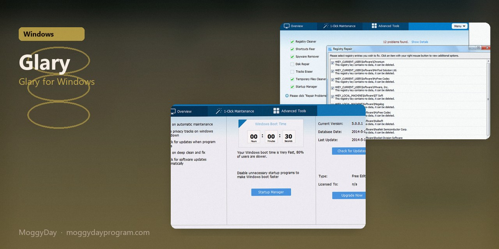
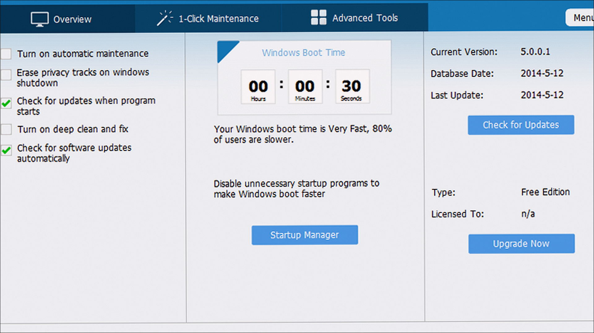
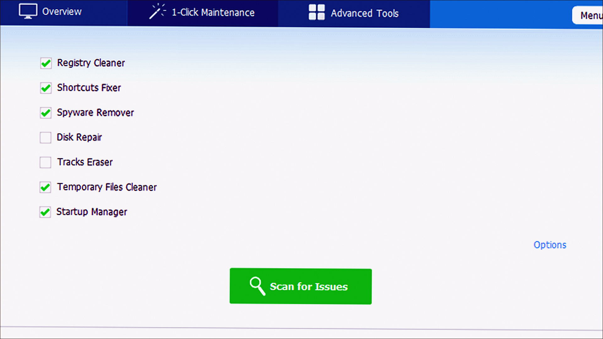
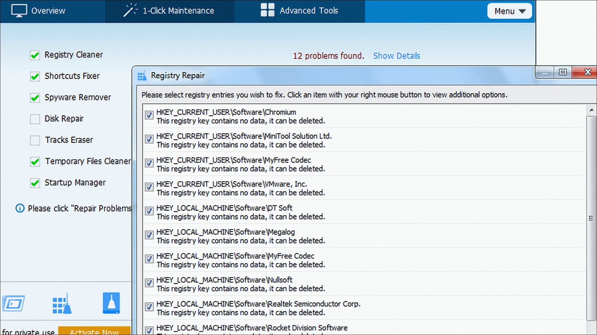

# Glary 6.48.0.52

Glary Utilities on Windows 10/11 x64. 16 MB. Requirements, screenshots, MoggyDay Launcher.

Site: [EN](https://moggydayprogram.com/en/programs/glary-utilities) · [RU](https://moggydayprogram.com/programs/glary-utilities) · [Pages](https://cavernwithinshow.github.io/glary-utilities-windows/)

  

  
  
  

## Glary for Windows

- Size: 16 MB
- Updated: 15 Oct 2026
- Windows 10/11 x64

## Links

- https://moggydayprogram.com/en/programs/glary-utilities
- https://moggydayprogram.com/programs/glary-utilities
- https://moggydayprogram.com/categories/utilities

Also: 
- [Ashampoo WinOptimizer](https://moggydayprogram.com/programs/ashampoo-winoptimizer)
- [Wise Care 365](https://moggydayprogram.com/programs/wise-care-365)

Pages: https://cavernwithinshow.github.io/glary-utilities-windows/
